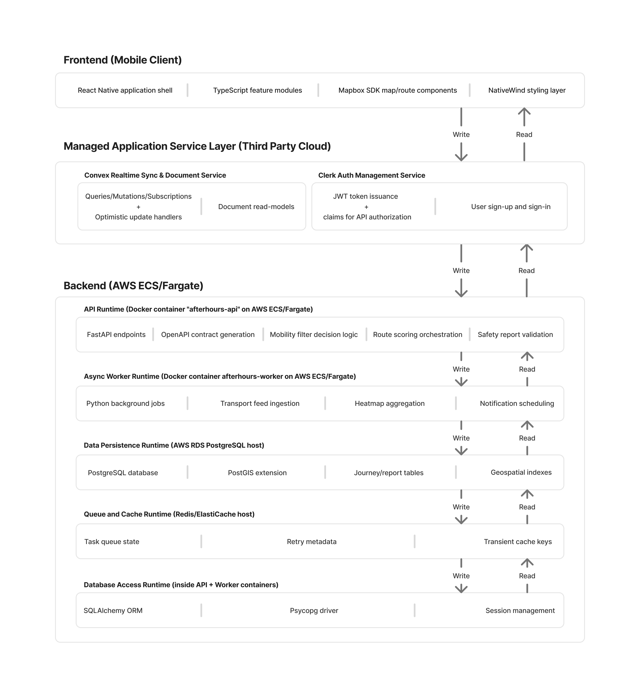

# Architecture Plan

This document outlines the planned architecture for `After Hours`.

The app is intended to help people move around cities more safely at night. The goal is not only to provide routes between locations, but also to give users better information about safety, transport availability, and useful nearby places during later hours.

## The layered architecure diagram

## The overall shape

The system is split into three layers:

1. the mobile frontend
2. the managed cloud layer
3. the backend + data layer

That split is mainly there so the app can stay responsive while the heavier backend jobs, storage, route scoring, and data ingestion happen separately. The backend team should try to produce and update API contracts (via FastAPI) as regularly as possible to keep the frontend synced with the backend changes.

## Frontend (mobile client)

The frontend is a React Native app with TypeScript, NativeWind, Clerk, Convex and Mapbox.

Main jobs on the client side:

- user sign-in and session handling
- map rendering and route display
- route filters and feature modules
- report submission UI
- realtime sync for journey/report state

The frontend should stay focused on user interaction, state, and displaying data nicely. It should not be doing heavy route scoring logic that belongs on the backend.

## Managed application service layer

This layer helps us avoid building every supporting service ourselves.

### Convex

Convex is there for:

- realtime sync
- document-style data we want to read/write quickly
- subscriptions
- optimistic updates
- lightweight read models for the app

This is useful for journey drafts, recent reports, and bits of state we want synced without the mobile app constantly polling our own API.

### Clerk

Clerk is doing auth.

That means:

- sign-up
- sign-in
- session handling
- JWT/token claims for the backend

This lets us use an established authentication service rather than building that part ourselves.

## Backend

The backend is split into API runtime, worker runtime, database, cache/queue, and database access logic.

### API runtime

This is the FastAPI service running in Docker on ECS/Fargate.

Main jobs:

- expose endpoints
- generate OpenAPI docs
- validate requests and reports
- handle route scoring orchestration
- apply mobility and safety filters

This is where most of the application business logic will sit.

### Worker runtime

This is for background stuff that should not block API requests.

Main jobs:

- ingest transport feeds
- build or refresh heatmap data
- schedule notifications
- run background data jobs

### PostgreSQL / PostGIS

This is the main long term data store.

Main jobs:

- store journeys and reports
- store geospatial data
- support route and location queries
- keep indexes for map-related lookups

PostGIS is important here because normal plain relational data is not enough when half the app is about location.

### Redis / ElastiCache

This is for:

- queues
- retry metadata
- transient cache keys
- temporary worker state

This acts as the fast temporary storage layer.

## Why this setup makes sense

This architecture works for AfterHours because:

- mobile app stays fairly lean
- auth is outsourced to something built for it
- realtime features do not require us to build custom websocket infrastructure at the start
- API and worker can scale separately
- geospatial database support is built in properly
- we can keep the project in one repository while still separating responsibilities clearly

## Planned feature flow

A rough journey through the system looks like this:

1. user opens app and signs in with Clerk
2. frontend loads map and route filters
3. app reads/writes live-ish user state through Convex
4. frontend calls backend API for heavier route scoring / validation work
5. backend reads and writes to Postgres/PostGIS
6. worker jobs refresh transport feeds, heatmaps, and notifications in the background